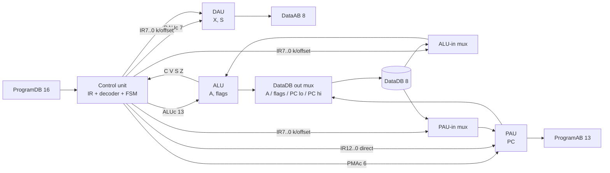

# Caltech10 8-bit CPU (ABEL-HDL, Lattice ispMACH 4000)

A complete 8-bit CPU that implements the **Caltech10** instruction set. I wrote it in ABEL-HDL for Caltech EE 10a (Introduction to Digital Logic and Embedded Systems) in winter/spring 2025, and fitted it to a single **Lattice LC4256V-10T176I** CPLD.

The CPU has four units, each its own ABEL module, joined by a top-level module:

| Unit | Source | Role |
|---|---|---|
| Program Memory Access Unit (PAU) | `PMA Design (1).abl` | 13-bit program counter; direct, relative and stack-loaded jumps |
| Data Memory Access Unit (DAU) | `GaboDAU.abl` | X and S index registers; data address generation for every addressing mode |
| ALU + status | `GaboALU.abl` | accumulator, F-block logic, adder, flag register with update masks |
| Control unit | `ControlGabo.abl` | instruction register, bit-pattern decoder, CALL/RTS state machine, bus strobes |
| Top level | `CPUTemplate.abl` | instantiates the four units, plus the bus multiplexers |

The top-level port list, the test vectors (`CPUStandard.abv`, `CPUInOut.abv`) and the instruction-set definition were provided by the course (instructor: Glen George). The four units and the top-level wiring are my design.

## Architecture

The CPU uses a **Harvard** layout: program memory and data memory have separate buses.

| Bus | Width | Direction |
|---|---|---|
| Program address `ProgramAB` | 13 bits (8K words) | out |
| Program data `ProgramDB` | 16 bits (one instruction per word) | in, read-only |
| Data address `DataAB` | 8 bits (256 bytes, plus a separate 256-port I/O space) | out |
| Data data `DataDB` | 8 bits | bidirectional, driven only during writes |
| Strobes | `RD`, `WR` (active in the low half of the clock), `IO` (memory 0 / I/O 1) | out |

Programmer-visible state: accumulator **A**, flag register (**C**, **V**, **S**, **Z**), index register **X**, stack pointer **S**, and the 13-bit **PC**. All of it is also routed to pins so it can be watched on the board.

### Top level (`CPUTemplate.abl`)

The top level adds three multiplexers that the units share:

- **DataDB output mux** (`DDSel1..0`) chooses what goes onto the data bus during a write: the accumulator (stores), the flags (`PUSHF`), `PC7..0` or `PC12..8` (the two return-address bytes that `CALL` pushes).
- **ALU input mux** (`ALUSel0`) feeds the ALU either the data bus (memory operands) or `IR7..0` (immediate `k` operands).
- **PAU input mux** (`PMASel0`) feeds the PAU either `IR7..0` (relative branch offset) or the data bus (return-address bytes popped by `RTS`).

`IR7..0` is also the DAU offset, and `IR12..0` is the PAU's direct jump target.

### ALU (`GaboALU.abl`)

The data path is F-block → AND gate → adder → accumulator, with a separate flag path:

1. **F-block.**
   - Four select lines form a truth table that is applied bit by bit:

     `F = Sel0·Ā·B̄ + Sel1·Ā·B + Sel2·A·B̄ + Sel3·A·B`

   - So one 4-bit code selects any of the 16 Boolean functions of A and B. For example, `0101` gives B, `0110` gives XOR, `1000` gives AND, `1110` gives OR.
2. **AND gate.** `SelAnd` feeds either A or 0 into the adder's other input. With A gated off, the adder simply passes the logic result through.
3. **Adder.** An 8-bit ripple-carry adder computes `AND-out + F + Cin`. The carry-in mux chooses 0, 1, C or ¬C. This one adder handles every arithmetic instruction:
   - `ADD`: F = B, Cin = 0.
   - `ADC`: F = B, Cin = C.
   - `SUB`: F = ¬B, Cin = 1.
   - `SBB`: F = ¬B, Cin = ¬C.
   - `CMP`: computed like `SUB`, then the result is thrown away.
   - `INC` / `DEC` / `NEG` are the same adder with constant operands.
4. **Accumulator write-back.** `SelA` holds A unchanged. That is how `CMP`, `TST` and the non-ALU instructions affect only the flags.
5. **Flags.**
   - Z = result is zero. S = bit 7.
   - V (signed overflow) = the two operands have the same sign and the result's sign differs.
   - C = carry-out, inverted for subtraction (`SelCarry`) so that it reads as a borrow.
   - An 8-bit **mask** decides which flags change: `SelSZ` gates S and Z, `SelVC` gates V and C. This gives the instruction set's per-instruction flag behaviour.
   - `SelPop` loads the flags straight from the ALU result, which implements `POPF`.

**Not implemented:** the shifter/rotator. In the source, the adder/shifter mux's shifter input is tied to 0 and the shifter carry `COutS` is constant 0, so shift and rotate instructions (e.g. `RLC`) do not produce a shifted result.

### Data Memory Access Unit (`GaboDAU.abl`)

Every data address is computed as `source + offset`:

- **Source mux:** X, S, or 0.
- **Offset mux:** `IR7..0` or 0.
- **Index update:** a separate incrementer/decrementer updates X or S (`SelX`, `SelS`, direction from `SelCarry`).
- **Pre/post mux:** `SelPre` chooses whether the address uses the register value before or after that update.

| Mode | Example | Address |
|---|---|---|
| Direct | `LDD m`, `STD m` | 0 + m |
| Indexed | `LD X + o`, `LD S + o` | X/S + o |
| Post-increment / post-decrement | `LD X+ + o`, `LD X- + o` | X + o, then X ← X ± 1 |
| Pre-increment / pre-decrement | `LD +X + o`, `LD -X + o` | X ← X ± 1, then X + o |
| Stack | `PUSHF`, `POPF`, `CALL`, `RTS` | the same machinery, with S as the source |

### Program Memory Access Unit (`PMA Design (1).abl`)

The PC is updated by a 13-bit adder: `PC ← mux + (PC or 0)`. The mux has four inputs:

| Select | Input | Used by |
|---|---|---|
| `Sel0` | `IR12..0` (PC input zeroed) | `JMP a`, `CALL a` |
| `Sel1` | `IR7..0` sign-extended to 13 bits | conditional relative branches |
| `Sel2` + `LowerBit` | a data-bus byte into `PC7..0` (PC zeroed), or into `PC12..8` (added) | the two `RTS` pops |
| `Sel3` | constant 1 | normal fetch, and the last cycle of `CALL`/`RTS` |

`Hold` forces the mux to 0, so the PC stays put while `CALL` pushes the return address. On reset the PC is cleared to 0.

### Control unit (`ControlGabo.abl`)

- **Instruction register.** Each instruction word from `ProgramDB` is clocked into `IR`. It is held there while a CALL/RTS sequence runs.
- **Hardwired bit-pattern decoder.** There is no microcode. Each of the 26 unit control lines (13 ALU, 7 DAU, 6 PAU), plus the mux selects and `RD`/`WR`/`IO`, is a sum of products over IR bit patterns. The comments name the instruction each product term decodes.
- **Conditional branches.** A branch is taken by selecting the relative-offset input (`PMAc1`) and not taken by selecting +1 (`PMAc3`). The condition is decoded together with the live flags:

| Branch | Taken when |
|---|---|
| `JA` / `JBE` | ¬C·¬Z / C + Z |
| `JAE` / `JB` | ¬C / C |
| `JNS` / `JS`, `JNZ` / `JZ`, `JNV` / `JV` | the single flag is clear / set |
| `JG` / `JLE` | ¬(S⊕V)·¬Z / (S⊕V) + Z |
| `JGE` / `JL` | ¬(S⊕V) / S⊕V |

- **CALL/RTS state machine.** A Moore FSM with 5 state bits, one-hot apart from the all-zero Idle state. It sequences the multi-cycle subroutine instructions:
  - `CALL a`: four cycles. Push PC+1 bits 12..8 (pre-decrement S), push PC+1 bits 7..0 and load `a`, then increment the PC.
  - `RTS`: three cycles. Pop into `PC7..0` (post-increment S), pop into `PC12..8`, then increment the PC.
- **Bus timing.** `RD` and `WR` are gated with `!Clock`, so memory is accessed in the second half of each cycle. The address has settled by then. `IO` selects the I/O space for `IN p`.

## Instruction coverage

What the decoder handles, as annotated in `ControlGabo.abl`:

| Group | Instructions |
|---|---|
| Arithmetic | `ADD`, `ADC`, `SUB`, `SBB`, `CMP`, `INC`, `DEC`, `NEG` |
| Logic | `AND`, `OR`, `XOR`, `NOT`, `TST` |
| Operand forms | memory `m`, `X, o`, `S, o`, immediate `…I k` |
| Load / store | `LDD`, `LDI`, `LD` / `ST` in all X/S indexed, pre- and post-increment/decrement modes, `STD` |
| Flags / stack | `PUSHF`, `POPF` |
| Control flow | `JMP a`, `CALL a`, `RTS`, the 14 conditional branches above, `NOP` |
| I/O | `IN p` |

## Implementation results

From the tool output committed with the project (ispLEVER Classic 2.1, target `LC4256V-10T176I`):

| Resource | Used |
|---|---|
| I/O pins | 82 |
| Macrocell outputs | 208 |
| Registers | 66 |
| Logic product terms | 840 |

The full pin assignment is in `gabocpu_pin.csv`. These numbers come from `gabocpu.log`. This repository does not include a simulation pass/fail summary, so none is claimed here.

## Repository layout

The repository is the whole ispLEVER Classic project directory, so most files are tool output. The ones worth reading:

| File | Contents |
|---|---|
| `CPUTemplate.abl` | top-level CPU module and bus muxes |
| `ControlGabo.abl` | control unit |
| `GaboALU.abl` | ALU, accumulator, flags |
| `GaboDAU.abl` | data memory access unit |
| `PMA Design (1).abl` | program memory access unit |
| `CPUStandard.abv`, `CPUInOut.abv` | course test vectors (standard set, and IN/OUT) |
| `gabocpu_pin.csv` | fitted pinout |
| `GABOcpu.syn` | project file (device, module list, top module) |

Everything else (`*.bl*`, `*.jhd`, `*.naf`, `*.lt*`, `*.tmv`, `*.crf`, `*.xrf`, logs) is produced by the ispLEVER flow. To rebuild, open `GABOcpu.syn` in ispLEVER Classic with `CPU` as the top module.
